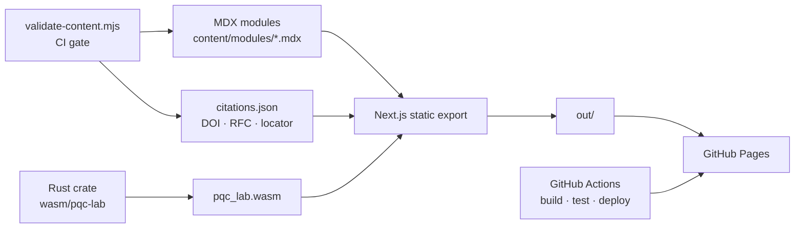

# CPSsec CyberLab Training

**An open, citation-backed cybersecurity curriculum with interactive labs and a deep post-quantum track.**

[](https://github.com/CPSsec-UCY/CPSsec-CyberLab-Training/actions/workflows/ci.yml)
[](https://github.com/CPSsec-UCY/CPSsec-CyberLab-Training/actions/workflows/deploy.yml)
[](./LICENSE)

Live site: <https://cpssec-ucy.github.io/CPSsec-CyberLab-Training/>

CPSsec CyberLab Training is maintained by the [CPSsec research group](https://github.com/CPSsec-UCY) at the
University of Cyprus. It turns cybersecurity into version-controlled, reviewable courses with
interactive visualisations, verifiable citations and browser-native labs. The curriculum spans
red team, application security, identity, cloud, malware, DFIR, SOC operations, cryptography,
distributed systems and post-quantum migration.

## Why this exists

Security is not one subject. A defender needs cryptography, packet-level visibility, distributed-system
trade-offs, SOC judgement and implementation reality. Post-quantum migration cuts across all of them.
Learners need a path from intuition to implementation without losing the provenance of each claim.

Every module is authored at four **depth lenses**:

| Lens | Audience | What it shows |
| --- | --- | --- |
| **L1 — Intuition & threat model** | Beginners, generalists | Visual mental models, attacker goals, real failure modes, no heavy maths |
| **L2 — Protocol & system mechanics** | Practitioners, engineers, students | Message flows, state machines, layouts, configuration trade-offs |
| **L3 — Formal math & correctness** | Cryptographers, researchers | Definitions, algebraic structures, bounds, reduction sketches |
| **L4 — Implementation & hardware** | Systems and crypto engineers | Constant-time code, SIMD, NTT/Keccak acceleration, side-channel and fault defences |

The lens switcher preserves scroll position and the reader's last choice. Every module covers all four
lenses; CI fails if one is missing.

## Curriculum

| # | Module | Track |
| --- | --- | --- |
| 01 | [Public-key primitives: PKE, KEM, signatures and security notions](content/modules/asymmetric-primitives.mdx) | Foundations |
| 02 | [Symmetric cryptography: AES, AEAD and key management](content/modules/symmetric-crypto.mdx) | Foundations |
| 03 | [Hashes, MACs and KDFs: integrity, authentication and key stretching](content/modules/hashing-mac-kdf.mdx) | Foundations |
| 04 | [Web application security: attacks, trust boundaries and defence](content/modules/web-application-security.mdx) | Application Security |
| 05 | [Identity and access management: OAuth, OIDC, WebAuthn and authorisation](content/modules/identity-access-management.mdx) | Identity & Access |
| 06 | [Cloud and container security: IAM, workloads, Kubernetes and attack paths](content/modules/cloud-container-security.mdx) | Cloud & Infrastructure |
| 07 | [Malware analysis and endpoint forensics: from first alert to evidence](content/modules/malware-endpoint-forensics.mdx) | Malware & Forensics |
| 08 | [Secure software supply chain: dependencies, builds, provenance and signing](content/modules/secure-software-supply-chain.mdx) | Software Supply Chain |
| 09 | [Deep packet inspection and network visibility](content/modules/deep-packet-inspection.mdx) | Network & Protocol Security |
| 10 | [SOC operations: detection, triage and incident response](content/modules/soc-operations.mdx) | Security Operations |
| 11 | [TLS, PKI and the hybrid migration](content/modules/tls-pki.mdx) | Network & Protocol Security |
| 12 | [Centralised vs decentralised systems: trust, consensus and failure](content/modules/centralised-decentralised.mdx) | Distributed Systems & Privacy |
| 13 | [Federated learning: privacy, poisoning and secure aggregation](content/modules/federated-learning.mdx) | Distributed Systems & Privacy |
| 14 | [Zero-knowledge proofs and secure multi-party computation](content/modules/zero-knowledge-mpc.mdx) | Advanced Cryptography |
| 15 | [Red team penetration testing: scope, lab methodology and attack reasoning](content/modules/red-team-penetration-testing.mdx) | Red Team |
| 16 | [Web exploitation and offensive tooling: from request trace to custom tool](content/modules/web-exploitation-offensive-tooling.mdx) | Red Team |
| 17 | [Malware reverse engineering and data science: from disassembly to detection](content/modules/malware-reverse-engineering-data-science.mdx) | Malware & Forensics |
| 18 | [Rootkits and bootkits: kernel hooks, firmware persistence and detection](content/modules/rootkits-bootkits.mdx) | Malware & Forensics |
| 19 | [Digital forensics and incident response: memory, filesystems and defensible evidence](content/modules/digital-forensics-incident-response.mdx) | Digital Forensics & Incident Response |
| 20 | [Blue team operations and threat hunting: hypotheses, detections and response](content/modules/blue-team-threat-hunting.mdx) | Security Operations |
| 21 | [The quantum threat: what actually breaks, and when](content/modules/quantum-threat.mdx) | Post-Quantum Cryptography |
| 22 | [NTT and polynomial rings: the arithmetic engine](content/modules/ntt-polynomials.mdx) | Post-Quantum Cryptography |
| 23 | [ML-KEM: module-lattice key encapsulation](content/modules/ml-kem.mdx) | Post-Quantum Cryptography |
| 24 | [ML-DSA: lattice signatures and the art of rejection](content/modules/ml-dsa.mdx) | Post-Quantum Cryptography |
| 25 | [SLH-DSA: signatures from hash functions alone](content/modules/slh-dsa.mdx) | Post-Quantum Cryptography |
| 26 | [Side channels and constant-time implementation](content/modules/side-channel.mdx) | Systems & Hardware |

The platform also includes a searchable glossary, a citation registry with BibTeX export, and 32 standalone workbenches spanning red team, web exploitation, malware reverse engineering, rootkits, DFIR, threat hunting, cloud, supply chain, privacy, protocols and PQC.

## Architecture



- **Static hosting:** Next.js 14 static export to GitHub Pages. No backend, no accounts, no analytics.
- **Content:** MDX with structured frontmatter, four `<Lens>` sections and inline `<Cite>` locators.
- **Citations:** `content/citations.json`; a Node validator enforces keys, types, URLs, locators,
  module coverage and inline/frontmatter consistency.
- **Interactivity:** React + Framer Motion for protocol and maths visualisers; SVG is inspectable.
  Explanatory sequences have play/pause/step controls and respect reduced-motion preferences;
  the production build checks their accessible controls in the exported HTML.
- **Tables:** Markdown and JSX tables render inside labelled, keyboard-focusable horizontal scroll regions;
  the production build checks every exported table for overflow handling.
- **Labs:** Rust compiled to `wasm32-unknown-unknown` with a hand-written C ABI plus browser-native labs
  for AEAD, hashing, federated learning, DPI, SOC triage and zero-knowledge proofs. A TypeScript
  fallback runs when Wasm is unavailable.
- **Progress:** localStorage only. Nothing is transmitted.

## Quick start

Requirements:

- Node.js **20** (Node 18.18+ may work locally; CI uses 20)
- Rust with the `wasm32-unknown-unknown` target (optional; a prebuilt Wasm artifact is checked in)

```bash
git clone https://github.com/CPSsec-UCY/CPSsec-CyberLab-Training.git
cd CPSsec-CyberLab-Training
npm ci

# optional: rebuild the Wasm lab
npm run build:wasm

npm run dev
# http://localhost:3000
```

For a production build with the GitHub Pages base path:

```bash
NEXT_PUBLIC_BASE_PATH=/CPSsec-CyberLab-Training npm run build
# static output in out/
```

## Scripts

| Command | Purpose |
| --- | --- |
| `npm run dev` | Local development server |
| `npm run validate` | Validate citations, frontmatter, lens coverage, learner-visible prose depth and glossary links |
| `npm run lint` | Next.js ESLint |
| `npm run typecheck` | TypeScript, no emit |
| `npm run test:tables` | Inspect the static export for wrapped, keyboard-accessible tables |
| `npm run test:animations` | Verify exported process diagrams include accessible playback controls |
| `npm run build` | Validate, statically export, then run rendering and animation regression checks |
| `npm run build:wasm` | Compile the Rust lab to `public/wasm/pqc_lab.wasm` |
| `npm run test:wasm` | Rust unit tests (NTT round-trip and multiplication) |
| `npm run validate:links` | Network link check for citation URLs (scheduled in CI) |

## Repository layout

```text
app/                    Next.js routes (home, curriculum, learn, lab, glossary, citations, about)
components/
  citations/            citation provider, inline <Cite>, drawer, registry
  depth/                four-lens provider, switcher and section wrapper
  lab/                  Wasm-backed NTT and compression workbenches
  learning/             knowledge checks and local progress
  modules/              module cards, header, navigation
  visualizers/          protocol and maths animations
  mdx/                  component mapping for MDX
content/
  citations.json        central citation registry
  glossary.json         cross-linked glossary
  modules/*.mdx         the curriculum
lib/                    module/citation/glossary loaders and Wasm engine wrapper
wasm/pqc-lab/           Rust crate and tests
scripts/                content validation, link checking, Wasm build
.github/workflows/      CI, Pages deploy, scheduled link check
```

## Citation policy

- Standards, RFCs, peer-reviewed papers and maintained reference implementations are preferred.
- Every inline claim that depends on an external source carries a precise locator
  (section, page, algorithm, table or RFC section), not just a URL.
- DOI links are used where available; RFCs use their canonical `rfc-editor.org` URLs.
- An inline citation must also appear in the module frontmatter so it is included in the module's
  primary-source list.
- Unknown keys, malformed records, missing locators and missing depth lenses fail `npm run validate`.
- The depth gate counts learner-visible prose, excluding code, JSX attributes and component configuration;
  a lesson cannot pass by inflating component props or duplicating generic templates. Exact repeated
  paragraphs are reported for author review.
- A scheduled workflow checks citation URLs for rot. Link failures are reported as workflow failures.

Corrections are first-class contributions. Open a
[citation correction issue](https://github.com/CPSsec-UCY/CPSsec-CyberLab-Training/issues/new/choose) or a pull
request.

## Contributing

Read [CONTRIBUTING.md](./CONTRIBUTING.md) for the authoring workflow, four-lens requirements and
validation commands. Module proposals use the issue template; code and content changes use the PR
template.

- Code of Conduct: [CODE_OF_CONDUCT.md](./CODE_OF_CONDUCT.md)
- Security policy: [SECURITY.md](./SECURITY.md)
- License: [EUPL-1.2](./LICENSE)

## Build plan status

- **Phase 1 — Foundation & citation engine:** complete.
- **Phase 2 — Core concept modules:** twenty-six courses across fourteen tracks and all four lenses, complete.
- **Phase 3 — Animations & labs:** 32 standalone workbenches plus a Rust→Wasm NTT/compression bench, covering red team, AppSec, IAM, cloud, malware, DFIR, SOC, privacy, protocols and PQC, complete.
- **Phase 4 — Learning features & community:** roadmap, progress, glossary cross-links, knowledge checks,
  contributor templates; ongoing expansion and review.

## Maintainers

Maintained by **CPSsec-UCY**. For project questions, use
[GitHub Discussions](https://github.com/CPSsec-UCY/CPSsec-CyberLab-Training/discussions); for security issues, use
the private advisory channel in [SECURITY.md](./SECURITY.md).

## License

Licensed under the European Union Public Licence **EUPL-1.2**. See [LICENSE](./LICENSE).
