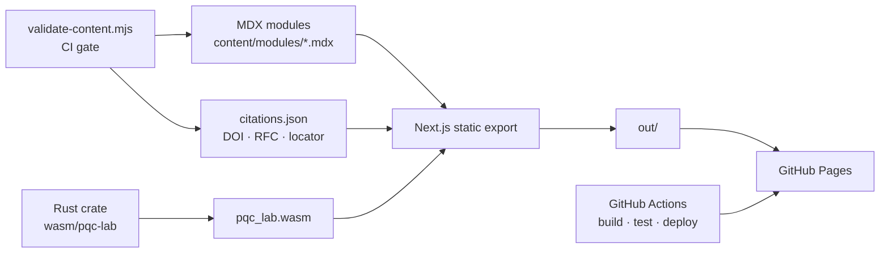

# CPSsec CyberLab

**An open, citation-backed cybersecurity learning platform with a deep post-quantum cryptography lab.**

[](https://github.com/CPSsec-UCY/pqc-cyberlab/actions/workflows/ci.yml)
[](https://github.com/CPSsec-UCY/pqc-cyberlab/actions/workflows/deploy.yml)
[](./LICENSE)

Live site: <https://cpssec-ucy.github.io/pqc-cyberlab/>

CPSsec CyberLab is maintained by the [CPSsec research group](https://github.com/CPSsec-UCY) at the
University of Cyprus. It turns cybersecurity and post-quantum cryptography into version-controlled,
reviewable modules with interactive visualisations, verifiable citations and a real WebAssembly
arithmetic lab.

## Why this exists

Post-quantum migration is not just a library swap. It changes protocol sizes, certificate chains,
firmware trust anchors, hardware buffers and side-channel requirements. Learners need a path from
intuition to implementation without losing the provenance of each claim.

Every module is authored at four **depth lenses**:

| Lens | Audience | What it shows |
| --- | --- | --- |
| **L1 — Intuition & threat model** | Beginners, generalists | Visual mental models, attacker goals, real failure modes, no heavy maths |
| **L2 — Protocol & system mechanics** | Practitioners, engineers, students | Message flows, state machines, layouts, configuration trade-offs |
| **L3 — Formal math & correctness** | Cryptographers, researchers | Definitions, algebraic structures, bounds, reduction sketches |
| **L4 — Implementation & hardware** | Systems and crypto engineers | Constant-time code, SIMD, NTT/Keccak acceleration, side-channel and fault defences |

The lens switcher preserves scroll position and the reader's last choice. Every module covers all four
lenses; CI fails if one is missing.

## Curriculum

| # | Module | Track |
| --- | --- | --- |
| 01 | [The quantum threat](content/modules/quantum-threat.mdx) | Foundations |
| 02 | [Public-key primitives](content/modules/asymmetric-primitives.mdx) | Foundations |
| 03 | [NTT and polynomial rings](content/modules/ntt-polynomials.mdx) | Lattice PQC |
| 04 | [ML-KEM (FIPS 203)](content/modules/ml-kem.mdx) | Lattice PQC |
| 05 | [ML-DSA (FIPS 204)](content/modules/ml-dsa.mdx) | Lattice PQC |
| 06 | [SLH-DSA (FIPS 205)](content/modules/slh-dsa.mdx) | Hash-Based Signatures |
| 07 | [TLS, PKI and hybrid migration](content/modules/tls-pki.mdx) | Systems & Deployment |
| 08 | [Side channels and constant-time code](content/modules/side-channel.mdx) | Systems & Deployment |

The platform also includes a searchable glossary, a citation registry with BibTeX export, and an
interactive lab for NTTs, polynomial multiplication, compression rounding and parameter trade-offs.

## Architecture



- **Static hosting:** Next.js 14 static export to GitHub Pages. No backend, no accounts, no analytics.
- **Content:** MDX with structured frontmatter, four `<Lens>` sections and inline `<Cite>` locators.
- **Citations:** `content/citations.json`; a Node validator enforces keys, types, URLs, locators,
  module coverage and inline/frontmatter consistency.
- **Interactivity:** React + Framer Motion for protocol and maths visualisers; SVG is inspectable.
- **Wasm lab:** Rust compiled to `wasm32-unknown-unknown` with a hand-written C ABI and a
  deterministic self-test. A TypeScript fallback runs when Wasm is unavailable.
- **Progress:** localStorage only. Nothing is transmitted.

## Quick start

Requirements:

- Node.js **20** (Node 18.18+ may work locally; CI uses 20)
- Rust with the `wasm32-unknown-unknown` target (optional; a prebuilt Wasm artifact is checked in)

```bash
git clone https://github.com/CPSsec-UCY/pqc-cyberlab.git
cd pqc-cyberlab
npm ci

# optional: rebuild the Wasm lab
npm run build:wasm

npm run dev
# http://localhost:3000
```

For a production build with the GitHub Pages base path:

```bash
NEXT_PUBLIC_BASE_PATH=/pqc-cyberlab npm run build
# static output in out/
```

## Scripts

| Command | Purpose |
| --- | --- |
| `npm run dev` | Local development server |
| `npm run validate` | Validate citations, frontmatter, lens coverage and glossary links |
| `npm run lint` | Next.js ESLint |
| `npm run typecheck` | TypeScript, no emit |
| `npm run build` | Validate then static export |
| `npm run build:wasm` | Compile the Rust lab to `public/wasm/pqc_lab.wasm` |
| `npm run test:wasm` | Rust unit tests (NTT round-trip and multiplication) |
| `npm run validate:links` | Network link check for citation URLs (scheduled in CI) |

## Repository layout

```text
app/                    Next.js routes (home, curriculum, learn, lab, glossary, citations, about)
components/
  citations/            citation provider, inline <Cite>, drawer, registry
  depth/                four-lens provider, switcher and section wrapper
  lab/                  Wasm-backed NTT and compression workbenches
  learning/             knowledge checks and local progress
  modules/              module cards, header, navigation
  visualizers/          protocol and maths animations
  mdx/                  component mapping for MDX
content/
  citations.json        central citation registry
  glossary.json         cross-linked glossary
  modules/*.mdx         the curriculum
lib/                    module/citation/glossary loaders and Wasm engine wrapper
wasm/pqc-lab/           Rust crate and tests
scripts/                content validation, link checking, Wasm build
.github/workflows/      CI, Pages deploy, scheduled link check
```

## Citation policy

- Standards, RFCs, peer-reviewed papers and maintained reference implementations are preferred.
- Every inline claim that depends on an external source carries a precise locator
  (section, page, algorithm, table or RFC section), not just a URL.
- DOI links are used where available; RFCs use their canonical `rfc-editor.org` URLs.
- An inline citation must also appear in the module frontmatter so it is included in the module's
  primary-source list.
- Unknown keys, malformed records, missing locators and missing depth lenses fail `npm run validate`.
- A scheduled workflow checks citation URLs for rot. Link failures are reported as workflow failures.

Corrections are first-class contributions. Open a
[citation correction issue](https://github.com/CPSsec-UCY/pqc-cyberlab/issues/new/choose) or a pull
request.

## Contributing

Read [CONTRIBUTING.md](./CONTRIBUTING.md) for the authoring workflow, four-lens requirements and
validation commands. Module proposals use the issue template; code and content changes use the PR
template.

- Code of Conduct: [CODE_OF_CONDUCT.md](./CODE_OF_CONDUCT.md)
- Security policy: [SECURITY.md](./SECURITY.md)
- License: [EUPL-1.2](./LICENSE)

## Build plan status

- **Phase 1 — Foundation & citation engine:** complete.
- **Phase 2 — Core concept modules:** eight flagship modules across L1–L4, complete.
- **Phase 3 — Animations & Wasm lab:** protocol/maths visualisers and a Rust→Wasm NTT/compression lab, complete.
- **Phase 4 — Learning features & community:** roadmap, progress, glossary cross-links, knowledge checks,
  contributor templates; ongoing expansion and review.

## Maintainers

Maintained by **CPSsec-UCY**. For project questions, use
[GitHub Discussions](https://github.com/CPSsec-UCY/pqc-cyberlab/discussions); for security issues, use
the private advisory channel in [SECURITY.md](./SECURITY.md).

## License

Licensed under the European Union Public Licence **EUPL-1.2**. See [LICENSE](./LICENSE).
